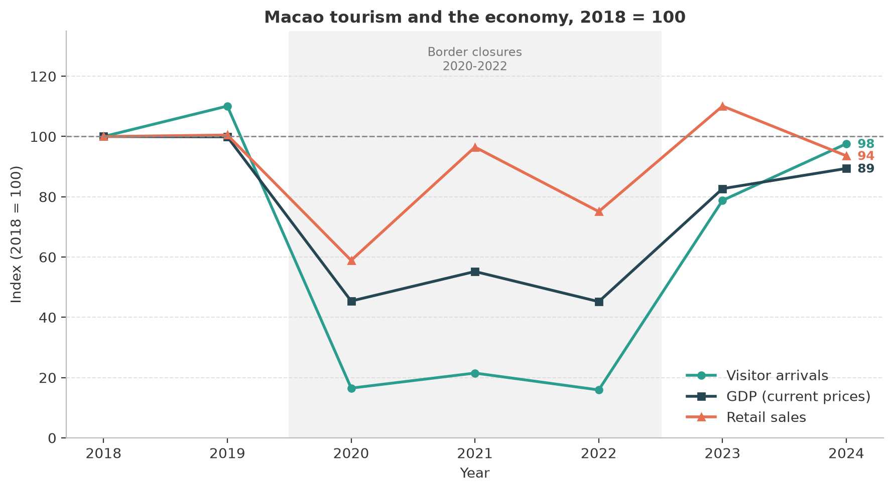

# Hi, I'm Kam 👋

MSc student in **Data Science at the University of Macau (UMAC)**. I use
Python and open data to answer concrete questions about the economy I live
in — lately, how tourism moves Macao's GDP and retail sales.

- 🎓 CISC7204 Data Science (2026–2027)
- 📍 Macao SAR
- 📫 Reach me via GitHub issues on any of my repositories

## Technical skills

| Area | Tools |
|---|---|
| Data wrangling & analysis | Python, pandas, numpy |
| Visualization | matplotlib, seaborn |
| Machine learning | scikit-learn (linear & ridge regression, pipelines, model evaluation) |
| Data acquisition | REST APIs (open-data portals), requests |
| Tooling | Jupyter, Git & GitHub, GitHub Pages, LaTeX |

---

## Project showcase

### 🇲🇴 The impact of visitor arrivals on Macao's economy (2018–2024)

**Research question:** *When visitor arrivals collapse and recover, how much
of that movement is mirrored in GDP and retail sales — and where does the
relationship break down?*

**What the figure shows.** All three series re-based to 2018 = 100. When the
borders closed (shaded band), visitor arrivals collapsed to ~16% of the 2018
level while GDP fell to ~45% and retail sales to ~59% — the broader the
series, the more of the shock it absorbs. By 2024 the recovery was broad but
incomplete (98 / 89 / 94).

**Key findings**

- Visitors and GDP correlate at **r ≈ 0.99**; a fitted line suggests roughly
  **7 billion MOP of GDP per additional million visitors** (r ≈ 0.89 even
  excluding the pandemic years).
- **Retail decouples from tourism in shock years:** spend per visitor jumped
  from ~2,000 MOP to ~10,100 MOP in 2020–2022, showing retail also contains
  resident consumption — so retail is a poor proxy for tourism activity.
- **Limitation:** with only 7 annual observations the regressions are
  descriptive, not causal; both variables share the same policy shocks.

**Status:** ✅ Completed · **Stack:** Python, pandas, numpy, matplotlib, requests
([DSEC open-data API](https://data.gov.mo))

🔗 **Repository:** [github.com/kamhong070-dot/data-science-project](https://github.com/kamhong070-dot/data-science-project)

---

*More projects are on the way — including machine-learning work from my
CISC7204 coursework.*
